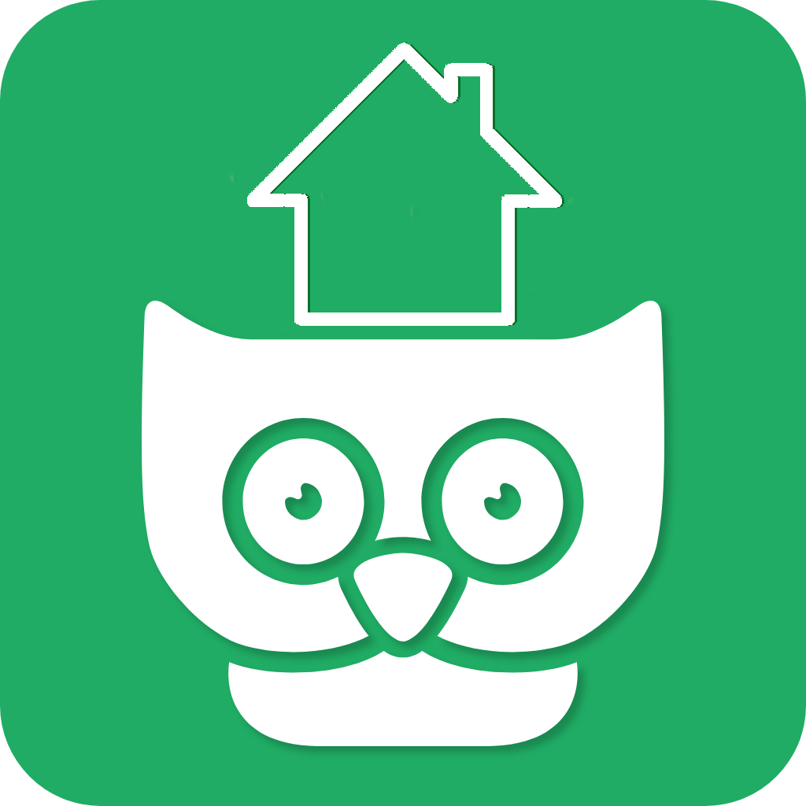

<h1 align="center">
  <picture>
    <source media="(prefers-color-scheme: dark)" srcset="./docs/docs/img/icon.png">
    
  </picture>
</h1>
<p align="center">
  <p align="center">A smart, self-hosted household manager.</p>
</p>

<h4 align="center">
  <a href="https://github.com/antebudimir/houseowl">Source</a> |
  <a href="https://github.com/antebudimir/houseowl/blob/main/CHANGELOG.md">Changelog</a>
</h4>

<h4 align="center">
  <a href="https://github.com/antebudimir/houseowl">
    
  </a>
  <a href="LICENSE">
    
  </a>
  <a href="https://github.com/antebudimir/houseowl/releases">
    
  </a>
  <a href="https://hub.docker.com/repository/docker/antebudimir/houseowl">
    
  </a>
</h4>

<h3 align="center">
 🏠 📝 🛒
</h3>

HouseOwl is a smart self-hosted household manager. Easily add items to your
shopping list before you go shopping, manage tasks, notes, birthdays, events,
and documents for everyone in your household.

- Native Mobile/Web/Desktop apps with a great design
- Add items to your shopping list and sync them in real-time with multiple users
- Partial offline support, so you don't lose track of what to buy even when there is no signal
- Manage tasks, notes, persons (with birthdays and gift ideas), and documents
- Share your household with friends and family

Please keep in mind that this project is still in development.

## 🍴 About this fork

This is a hard fork of [KitchenOwl](https://github.com/kitchenowl/kitchenowl) (upstream: [TomBursch/kitchenowl](https://github.com/TomBursch/kitchenowl)),
evolving it from a grocery list and recipe manager toward a broader household
coordination app. Planned additions include tasks, a shared calendar,
contacts, document storage, and planned purchases.

Landed so far:

- Manage shopping lists directly from the main-view header: add, rename, and
  delete lists inline (long-press a list for its actions)
- Shopping-list renames sync to all household members in real time
- Tasks, notes, events, persons with birthdays and gift ideas, documents,
  loyalty cards, planned buys
- Full rebrand from KitchenOwl to HouseOwl (see [CHANGELOG.md](CHANGELOG.md))

See [CHANGELOG.md](CHANGELOG.md) for the full history of fork changes.

## 📱 Screenshots

<table>
  <tr>
    <td></td>
    <td></td>
    <td></td>
    <td></td>
   </tr>
</table>

## 🤖 App Install

There are no store builds of this fork. Run the web app via the docker images
below, or build the mobile/desktop apps from source:

```sh
git clone https://github.com/antebudimir/houseowl
cd houseowl/kitchenowl
flutter pub get
flutter gen-l10n   # required on fresh clones before the first build
flutter run
```

> **Note (Android):** the app id changed from `com.tombursch.kitchenowl` to
> `com.antebudimir.houseowl`. Android treats this as a different app —
> in-place upgrades from KitchenOwl are not possible; install fresh.

## 🚀 Get started (self-hosting)

```sh
mkdir houseowl && cd houseowl
wget https://raw.githubusercontent.com/antebudimir/houseowl/main/docker-compose.yml
podman compose up -d
```

For advanced setups see the [upstream self-hosting docs](https://docs.kitchenowl.org/latest/self-hosting/)
(still accurate except for image names and `podman compose`).

## 🙌 Contributing

From opening a bug report to creating a pull request: every contribution is appreciated and welcomed. If you're planning to implement a new feature or change the API please create an issue first. This way, we can ensure your work is not in vain.
For more information see [Contributing](CONTRIBUTING.md).

### 🌍 Translations

Translations live in `kitchenowl/lib/l10n/*.arb`. Add or edit strings there and
run `flutter gen-l10n`.


## 🛎️ Stay Up-to-Date

KitchenOwl is moving fast, to stay updated consider starring and watching the releases of this repository.

### 💬 Status

- [x] Public Alpha: Still working on stuff (rarely things might break)
- [ ] Public Beta: Stable and most planned features complete
- [ ] Public: Production-ready

## 📚 Related

- [Website](https://kitchenowl.org)
- [Docs](https://docs.kitchenowl.org)
- [KitchenOwl Backend](https://github.com/TomBursch/kitchenowl-backend) Repository
- [KitchenOwl Website](https://github.com/TomBursch/kitchenowl-website) Repository
- [KitchenOwl Python Client](https://github.com/TomBursch/kitchenowl-python) Repository
- [KitchenOwl Home Assistant Integration](https://github.com/TomBursch/kitchenowl-ha) Repository
- [DockerHub](https://hub.docker.com/r/tombursch/kitchenowl)
- [Recipe scrapers](https://github.com/hhursev/recipe-scrapers) used for scraping recipes from the web
- [Weblate](https://weblate.org/) is helping with continuous localization as part of their ongoing support for open-source software projects.

### 🔨 Built With

- [Flask](https://flask.palletsprojects.com/)
- [Flutter](https://flutter.dev/)
- [Docker](https://docs.docker.com/)

## 🍀 Contributors

<a href="https://github.com/tombursch/KitchenOwl/graphs/contributors">
  
</a>

## 📜 License

KitchenOwl is Free Software: You can use, study share and improve it at your will. Specifically you can redistribute and/or modify it under the terms of the AGPL-3.0 License.
